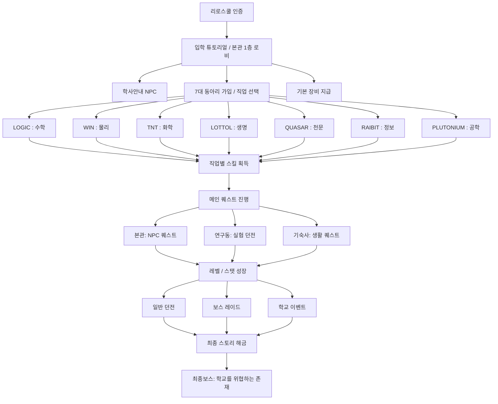

# 🌌 인천과학고 (ISHS) RPG 세계관 및 게임 설계도

이 시스템을 기반으로 단순한 "학교 서버"를 넘어 **실제 학교를 하나의 거대한 RPG 세계관으로 바꾸는 MMORPG 구조**입니다.

---

## 🗺️ 전체 개략도

---

## 📜 챕터별 진행 순서

### Chapter 0. 입학
* **로직**: 리로스쿨 인증 -> 튜토리얼 -> 기본 무기 지급 -> 본관 소개
* **주요 NPC**: 교감선생님, 행정실장, 학생회

### Chapter 1. 동아리 선택 (직업 결정)
* 7개 연구동(LOGIC, WIN, TNT, LOTTOL, QUASAR, RAIBIT, PLUTONIUM) NPC 빙문
* 1개의 동아리를 선택하여 마법/물리/폭발/생명 등 고유 직업 획득

### Chapter 2. 7대 전초기지 (각 동아리 세력권)
* **장소**: 각 동아리별 연구동 및 기숙사
* **특징**: 자신의 동아리 외 구역에 들어가면 적대 세력으로 간주되어 언제든 기습 PvP가 발생할 수 있음.
* 기장(각 동아리장 NPC)에게 말을 걸어 동아리 고유 임무(장비 제작, 거점 방어 등)를 수행.

### Chapter 3. 국지전 및 세력 확장
각 동아리가 자원과 '연구실 점유율'을 두고 다투는 진영전(PvP):
* **LOGIC**: 수리적 분석을 통한 버프와 진형 파괴 위주의 전략형 전투
* **WIN**: 물리적 충격파와 강력한 근접 피해를 앞세운 돌파전
* **TNT**: 광역 폭발과 시야 차단을 활용한 교란전
* **LOTTOL**: 체력 흡수와 자가 치유를 극대화한 유지력 전투
* **QUASAR**: 공간 이동과 원거리 타겟팅을 활용한 저격전
* **RAIBIT**: 빠른 기동성과 은신, 시야 해킹을 통한 암살전
* **PLUTONIUM**: 중갑 방어와 설치형 포탑을 통한 지역 방어전

---

## ⚔️ 대규모 동아리 전쟁 시스템 (PvP 구역)

| 전쟁터 | 전투 테마 | 점령 보상 |
| :--- | :--- | :--- |
| **대운동장** | 중앙 대규모 난투, 힘의 충돌 | 근력 및 거점 체력 버프 |
| **실험동 복도** | 좁은 골목에서의 게릴라전 | 아이템 상점 독점권 |
| **천문대 옥상** | 넉백과 낙사를 활용한 거점 점령전 | 쿨타임 감소 버프 |
| **도서관** | 숨죽인 암살전 및 은신, 기습 | 지능/스킬 뎀 증가 |

---

## 🕵️‍♂️ 일상과 정치 가담 (중립 지대)
유저들은 단순히 싸우는 것을 넘어, 본관이나 매점 같은 '중립 지대'에서는 정치질과 스파이 활동을 펼침.

* **최종 목표**: 학교 최고의 동아리로 군림하여 '전설의 기장' 칭호를 획득하는 것.
* **공략법**: 타 동아리와 일시적 동맹을 맺거나 배신하여 세력을 확장.

---

## 👥 10대 핵심 NPC 라인업
전쟁을 부추기거나 중재하는 입체적인 마스터들.
1. **교장선생님** : 동아리들의 경쟁을 관망하며, 최종 우승자에게 절대 권력을 약속함.
2. **교감선생님** : 입학 통제 및 인증 확인 (중립)
3. **행정실장** : 기본 물품 지원 및 중립 상인 (돈만 있으면 누구에게나 팜)
4. **LOGIC 기장** : 수학 기장 (가입 및 퀘스트)
5. **WIN 기장** : 물리 기장 (가입 및 퀘스트)
6. **TNT 기장** : 화학 기장 (가입 및 퀘스트)
7. **LOTTOL 기장** : 생명 기장 (가입 및 퀘스트)
8. **QUASAR 기장** : 천문 기장 (가입 및 퀘스트)
9. **RAIBIT 기장** : 정보 기장 (가입 및 퀘스트)
10. **PLUTONIUM 기장** : 공학 기장 (가입 및 퀘스트)

## ✨ 성장 및 엔드 콘텐츠
* **성장 곡선**: 레벨 -> 스탯 -> 동아리 PvP 참가 -> 킬/데스 기록 -> 전설 칭호
* **엔드 콘텐츠**:
  * 매주 금요일 밤 '동아리 점령전' (공성전)
  * 기장 선발전 (가장 강력한 유저가 NPC를 밀어내고 기장 타이틀 획득)
  * 타 동아리 소탕 작전
